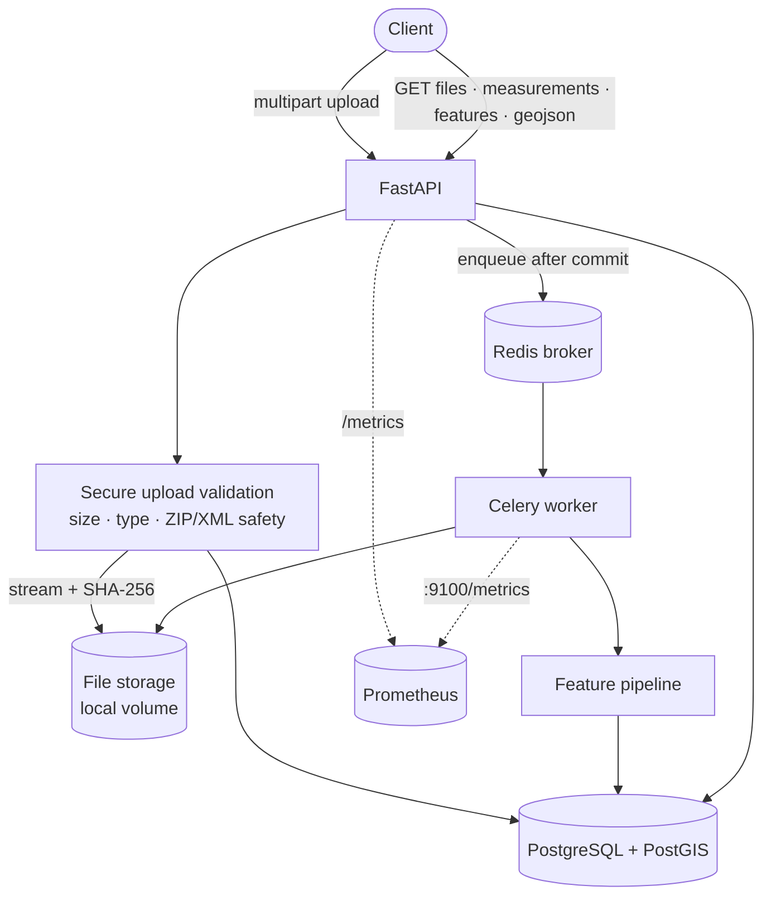
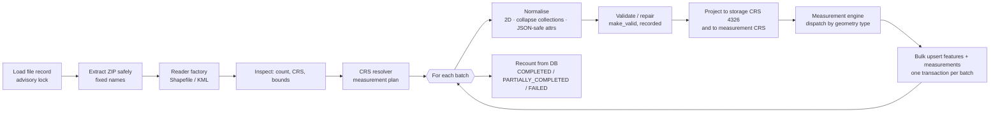

# GeoMeasure Engine

**GeoMeasure Engine — Production-Grade Geospatial File Measurement & Analysis API**


GeoMeasure Engine is a FastAPI service that securely ingests Shapefile (`.zip`) and KML
files, extracts every feature, resolves a **metric** coordinate reference system for
measurement, computes polygon area and line length, persists features and results in
PostgreSQL/PostGIS, and serves them through a versioned REST API. Heavy work runs in Celery
workers, so uploads return `202 Accepted` immediately.

The single most important rule of the project: **area and length are never computed from
latitude/longitude degrees.**

- [Overview](#overview) · [Features](#key-features) · [Architecture](#architecture) · [Quick start](#quick-start)
- [CRS handling](#crs-handling) · [Security](#security-model) · [API](#api) · [Design decisions](#design-decisions)
- [Testing](#testing) · [Performance](#performance) · [Limitations](#limitations) · [Future scope](#future-scope)

---

## Overview

### Problem statement

Given an uploaded geospatial file (`.zip` Shapefile or `.kml`), return for each feature its
index, geometry type, geometry, CRS, attributes and — for polygons — area, for lines —
length. Points need no measurement. Unsupported geometry must degrade gracefully, and
geographic coordinates (EPSG:4326) must be projected before measuring.

### Why this project

Naive implementations call `shapely.geometry.area` on lon/lat coordinates and return square
*degrees*. A degree of longitude is ~111 km at the equator and 0 km at the poles, so such
numbers are not physical quantities. This project makes CRS correctness, safe ingestion of
untrusted files, and failure isolation per feature the core of the design, and backs each
claim with automated tests (see [Testing](#testing)).

### Key features

| Capability | Status |
| --- | --- |
| KML ingestion | Implemented |
| Shapefile ZIP ingestion | Implemented |
| Polygon area (m², ha) | Implemented |
| LineString length (m, km) | Implemented |
| CRS-safe measurement (never degrees) | Implemented, tested against independent geodesic references |
| Geometry validation + recorded repair | Implemented |
| MultiPolygon / MultiLineString | Implemented |
| Point / MultiPoint | Implemented (`NOT_REQUIRED`, null values) |
| GeometryCollection | Homogeneous → collapsed and measured; mixed → `UNSUPPORTED` (graceful) |
| Async processing (Celery + Redis) | Implemented, tested with a real worker |
| PostGIS storage + GiST index | Implemented |
| Spatial filtering (`bbox`, `geometry_type`) | Implemented (PostGIS `ST_Intersects`) |
| GeoJSON output (RFC 7946, WGS 84, paginated) | Implemented |
| Idempotent, retry-safe jobs | Implemented, tested |
| Pagination | Implemented |
| Secure ZIP/KML ingestion | Implemented, 40+ automated security tests |
| Structured logging, request IDs, Prometheus metrics | Implemented |
| OpenTelemetry tracing | Implemented, **off by default**, optional extra, not exercised against a collector here |
| Docker / Compose | Written; **not executed in the authoring sandbox** (see [Verification status](#verification-status)) |
| GitHub Actions CI | Written; **not executed** (same reason) |
| Authentication / multi-tenancy | Not implemented (out of scope) |
| OGC API – Features conformance | Not claimed; used only as design inspiration |

---

## Architecture



### Processing pipeline (inside the worker)



### Tech stack

| Layer | Choice |
| --- | --- |
| API | Python 3.12, FastAPI, Pydantic v2, Uvicorn |
| Geospatial | GeoPandas, Shapely 2 (GEOS), PyProj (PROJ), Pyogrio (bundled GDAL/OGR) |
| Database | PostgreSQL 16 + PostGIS 3.4, SQLAlchemy 2, GeoAlchemy2, Alembic, psycopg 3 |
| Async | Celery + Redis |
| Quality | uv, Ruff, MyPy (strict), Pytest, Bandit, pip-audit, pre-commit |
| Ops | Docker (multi-stage, non-root), Docker Compose, GitHub Actions, Prometheus client, optional OpenTelemetry |

GDAL, GEOS and PROJ (including PROJ data) are shipped inside the pyogrio/shapely/pyproj
wheels, so the container needs no system GIS packages and does not depend on the host's GIS
installation. Exact dependency versions are pinned in `uv.lock`.

### Project structure

```text
app/
  main.py                 app factory, middleware, handlers
  api/                    routers (v1), dependencies, RFC 9457 error handlers
  core/                   settings, logging, exceptions, metrics, telemetry, middleware
  domain/enums.py         statuses, error codes
  db/                     SQLAlchemy models, session, advisory locks
  repositories/           all SQL lives here (file, job, feature, measurement)
  schemas/                Pydantic request/response models
  services/               file ingestion, processing orchestration, storage, queue, cleanup
  geospatial/
    readers/              GeoFileReader protocol, Shapefile + KML readers, factory
    crs/                  MeasurementCRSResolver, vectorised transformer
    geometry/             normaliser, validator/repairer, helpers
    measurements/         calculators per geometry type + MeasurementEngine
    pipeline.py           per-batch pipeline (pure: no I/O)
  tasks/                  Celery app + process_geospatial_file task
  utils/                  file/ZIP/KML validation, hashing, pagination, timing
alembic/                  migrations (0001 enables PostGIS and creates the schema)
scripts/                  sample data, smoke test, benchmark, cleanup
tests/                    unit · geospatial · security · integration · api · performance
docker/app/Dockerfile     multi-stage; targets `api` and `worker`
```

Business logic never lives in route handlers; routers call services/repositories. The
geospatial package has no dependency on FastAPI or the database, so it can be lifted into a
separate service later without touching the API.

---

## Quick start

### Docker (recommended)

```bash
git clone <repo-url> geo-measure-engine
cd geo-measure-engine
cp .env.example .env          # development placeholders; change POSTGRES_PASSWORD for anything real
docker compose up --build
```

Compose starts PostGIS, Redis, a one-shot `migrate` job (`alembic upgrade head`), the API
on <http://localhost:8000> and a Celery worker. Migrations run **only** in that explicit
job, never implicitly on API start-up. Uploads live in the named volume `uploads`, shared by
API and worker; database files in `pgdata`.

- Swagger UI: <http://localhost:8000/docs> · OpenAPI: `/openapi.json`
- Liveness `/health/live`, readiness `/health/ready`, metrics `/metrics`
- Stop: `docker compose down` (add `-v` to delete data)

Try it:

```bash
curl -X POST -F "file=@sample_data/sample.kml" http://localhost:8000/api/v1/files/
# → copy "id", then:
curl http://localhost:8000/api/v1/files/<id>/
curl http://localhost:8000/api/v1/files/<id>/measurements/
python3 scripts/smoke_test.py          # automated end-to-end check of all samples
```

### Without Docker

Requires Python 3.12+, [uv](https://docs.astral.sh/uv/), a PostgreSQL with PostGIS, and Redis.

```bash
cp .env.example .env                  # then point DATABASE_URL / REDIS_URL / FILE_STORAGE_PATH at your services
make install                          # uv sync --frozen --group dev --extra tracing
make migrate                          # alembic upgrade head
make dev                              # terminal 1: API on :8000 (reload)
make worker                           # terminal 2: Celery worker
make smoke                            # terminal 3: end-to-end check
```

For a demo without a worker or Redis, set `CELERY_TASK_ALWAYS_EAGER=true`: the task then runs
inline inside the upload request (same code path, just synchronous).

Create future migrations with `make migration m="describe change"` (autogenerate) and apply
with `make migrate` / `alembic upgrade head`.

### Make targets

`make help` lists them: `install dev worker test test-all lint format typecheck security
check migrate migration docker-up docker-down sample-data smoke bench cleanup clean`.

### Sample data

`sample_data/` is generated deterministically (`make sample-data`) near Karur, Tamil Nadu
(UTM zone 44N): `sample.kml` (Point, LineString, Polygon with hole, MultiPolygon, a self-
intersecting "bow-tie" polygon that gets repaired, MultiLineString), `sample_shapefile.zip`
(polygons), `sample_shapefile_lines.zip`, `sample_shapefile_points.zip`,
`sample_shapefile_no_prj.zip` (demonstrates `CRS_UNKNOWN`) and `expected.json` — reference
values computed **independently** with geodesic math on the WGS 84 ellipsoid.

> A Shapefile holds exactly **one** geometry type, so polygons, lines and points are three
> separate archives. An archive containing several `.shp` files is rejected (`MULTIPLE_SHAPEFILES`)
> rather than guessing which one was meant.

---

## CRS handling

### Why geographic coordinates cannot be measured directly

EPSG:4326 coordinates are angles. One degree of longitude spans ~111 km at the equator and
shrinks with `cos(latitude)`; one degree of latitude is ~110.6 km. `polygon.area` on such
coordinates is square degrees — a number that changes with *where* the polygon is. The test
suite proves the engine does not do this: the same 0.01°×0.01° square has ~1.2×10⁶ m² at
10.9°N, and exactly half as much at 60°N (`test_degree_square_area_depends_on_latitude`).

### Three distinct CRS roles

| Role | Meaning | Value |
| --- | --- | --- |
| **Source CRS** | What the file declares | Shapefile: from `.prj`. KML: WGS 84 by specification. Never altered or guessed. |
| **Storage CRS** | Queryable geometry in PostGIS | Always EPSG:4326 (lon/lat) |
| **Measurement CRS** | Where area/length are computed | Chosen by `MeasurementCRSResolver` |

Every file response exposes `source_crs`, `measurement_crs`, `measurement_units`,
`source_crs_name`, `measurement_crs_name` and a human-readable `crs_selection_reason`.

### Resolution strategy (`MeasurementCRSResolver`)

| # | Situation | Behaviour |
| --- | --- | --- |
| 1 | No CRS (e.g. Shapefile without `.prj`) | **Never guessed.** Features are stored (without geometry, which cannot be placed on the globe); polygons/lines get `FAILED` + `CRS_UNKNOWN`; points are `NOT_REQUIRED`. |
| 2 | Projected, metre units | Used directly (unless Mercator, see 4). |
| 3 | Projected, non-metre (feet…) | Reprojected to a metric local UTM CRS. |
| 4 | Mercator family (incl. EPSG:3857) | Metre-valued but area/length distortion grows with latitude, so it is **not trusted**; reprojected to local UTM. (Test: a 1 km Web-Mercator square at 60°N measures ~250 000 m², not 1 000 000.) |
| 5 | Geographic | Local UTM zone chosen from the centre of the dataset extent via `pyproj.database.query_utm_crs_info` — the same method as GeoPandas `estimate_utm_crs`. |
| 6 | Extent wider than one UTM zone (`UTM_MAX_LON_SPAN_DEG`, default 6°), crossing the antimeridian, or beyond 80°S–84°N | Area in **EPSG:6933** (WGS 84 equal-area, metres); length computed **geodesically** on the WGS 84 ellipsoid (`calculation_method = geodesic_wgs84`). No single metric CRS preserves length globally. |

No CRS codes are hand-written except the documented global equal-area fallback (EPSG:6933);
UTM zones come from the PROJ database. Axis order is always (x=lon, y=lat) via
`Transformer(..., always_xy=True)`, independent of what the CRS definition declares.

### Worked example (real output)

`sample.kml`, EPSG:4326 → UTM 44N → metres:

```json
{
  "source_crs": "EPSG:4326",
  "measurement_crs": "EPSG:32644",
  "measurement_units": "metre",
  "crs_selection_reason": "Source CRS EPSG:4326 is geographic (angular units); estimated local UTM CRS EPSG:32644 from dataset bounds (centre lon=78.1650, lat=10.9350)"
}
```

| Feature | Geodesic reference (independent) | API (UTM 44N) | Difference |
| --- | --- | --- | --- |
| Plot A (0.01°×0.01° square) | 1 209 259.12 m² | 1 211 395.13 m² | +0.18 % |
| Canal (LineString) | 4 900.65 m | 4 905.13 m | +0.09 % |
| Raw `polygon.area` in degrees | — | 0.0001 | not a metre value |

### Accuracy

Results are an engineering approximation, bounded by: source CRS quality, projection choice,
geometry validity, dataset extent and coordinate precision. UTM's scale factor is 0.9996 on
the central meridian and grows outward; this sample sits ~3° off zone 44's meridian (k≈1.0009,
so area ≈ +0.18 %) — which is exactly the difference in the table. The test suite therefore
asserts agreement within **0.3–0.5 %** of an independent geodesic computation, not exactness.
If you need sub-0.1 % accuracy over large extents, a geodesic or purpose-built local
projection strategy is more appropriate; the resolver is a replaceable component
(`CRSResolutionStrategy` protocol) for exactly that reason. Non-WGS-84 geographic datums are
treated as WGS 84 for UTM *selection* only; the transformation to the measurement CRS uses
the source CRS properly.

---

## Measurement strategy

| Geometry | Result |
| --- | --- |
| Polygon, MultiPolygon | `area_m2`, `area_hectares` (1 ha = 10 000 m²), `length_*` null |
| LineString, MultiLineString | `length_m`, `length_km`, `area_*` null (multi: sum of parts) |
| Point, MultiPoint | `NOT_REQUIRED`; all numbers null (never a fabricated `0`) |
| Empty / NULL geometry | `NOT_MEASURABLE` |
| Mixed GeometryCollection, other | `UNSUPPORTED` + `UNSUPPORTED_GEOMETRY` (no crash) |

Full double precision is stored; nothing is rounded in the database. `MeasurementEngine`
dispatches through a registry of calculators (`MeasurementCalculator` protocol) — no
if/elif chains in routes.

### Validation and repair

Each non-empty geometry is checked for finite coordinates and validity. Invalid geometries
are repaired with `shapely.make_valid` (GEOS MakeValid, `linework` method), then reduced to
parts of the original dimensionality. **Repair is never silent**: `is_valid_before`,
`is_valid_after`, `was_repaired` and `repair_method` are persisted, the repaired type can
differ from the source type (a bow-tie `Polygon` becomes a two-lobe `MultiPolygon`, recorded
as `source_geometry_type = Polygon`), and `validity_status` is `REPAIRED`. If repair
fails, that feature is `FAILED` with `GEOMETRY_REPAIR_FAILED`; other features continue.

### Normalisation rules

Z/M values are dropped (2-D measurement). Homogeneous GeometryCollections (e.g. KML
`MultiGeometry` of polygons) collapse to Multi*; mixed collections are kept and reported
`UNSUPPORTED`. Attribute values are made JSON-safe (numpy scalars, NaN/Inf → null, dates →
ISO strings, Decimal → float, bytes decoded, blank strings → null). Attribute strings are
truncated at `MAX_PROPERTY_VALUE_CHARS`, and if a feature's attributes exceed
`MAX_PROPERTIES_BYTES` their values are dropped; both are reported in the measurement
`warning` — never silent. KML presentation columns GDAL adds (`tessellate`, `visibility`,
`extrude`, `icon`, …) are dropped as they are styling, not data.

---

## Processing flow in detail

1. **Upload** — extension decides the candidate type; a *contradicting* `Content-Type` is
   rejected (415), it never confirms anything.
2. **Streamed to disk** in 1 MiB chunks under a UUID name, SHA-256 computed on the fly, limit
   enforced while streaming (partial file removed on overflow).
3. **Structural validation** — ZIP: entries, names, symlinks, nesting, sizes, ratios,
   components, `.shp` header signature. KML: well-formed XML via `defusedxml`, `<kml>` root,
   DTDs/entities/external references forbidden.
4. **Persist** `FileRecord` (`UPLOADED`) + `ProcessingJob`, commit, then **enqueue** (so the
   worker always sees the rows); `UPLOADED → QUEUED` is a conditional update that cannot
   overwrite a status a fast worker already advanced. Queue outage → `503`, nothing left behind.
5. **Worker** takes a PostgreSQL advisory lock on the file (no double processing), marks
   `PROCESSING`, securely extracts (fixed names `dataset.<ext>`, real byte budget).
6. **Reader selection** by file type; `inspect()` yields feature count, CRS and bounds.
7. **CRS resolution** → measurement plan (or a recorded CRS error).
8. **Per batch** (`FEATURE_BATCH_SIZE`): normalise → validate/repair → transform → measure →
   bulk upsert features + measurements + job progress in **one transaction**.
9. **Finalise** — counters are recounted from the database (never from in-memory tallies):
   0 failed → `COMPLETED`; some failed → `PARTIALLY_COMPLETED`; none succeeded or a
   file-level error → `FAILED`. Temporary directories are removed by context managers on
   success, failure and retry.

### Failure policy

| Level | Examples | Behaviour |
| --- | --- | --- |
| **Feature** | NULL/empty geometry, unrepairable geometry, NaN coordinates, unknown CRS, too many vertices | Feature is stored with a failed/not-measurable measurement; **processing continues** |
| **File** (non-retryable) | corrupt Shapefile, unreadable KML, empty dataset | `FAILED` + error code; **no retry** (same input, same result) |
| **Infrastructure** (retryable) | database connection loss, Redis/storage `OSError` | Status back to `QUEUED`, Celery retries with exponential backoff (`TASK_RETRY_BACKOFF_SECONDS`, cap `TASK_RETRY_BACKOFF_MAX_SECONDS`, `TASK_MAX_RETRIES`); after the last attempt `FAILED` |

`feature_count = successful_feature_count + failed_feature_count` is enforced by a database
`CHECK` constraint for terminal statuses. "Successful" = `COMPLETED` or `NOT_REQUIRED`.

### Idempotency

Feature primary keys are deterministic (`uuid5(file_id, feature_index)`), and writes are
`INSERT … ON CONFLICT (file_id, feature_index) DO UPDATE` (measurements on `feature_id`).
Re-running a job after a crash, a redelivery (`acks_late` + `reject_on_worker_lost`) or a
retry therefore rewrites the same rows. A terminal file is never reprocessed; the advisory
lock prevents two workers running the same file. Tested in
`tests/integration/test_processing_service.py` and `test_repositories.py`.

### File lifecycle and retention

`UPLOADED → QUEUED → PROCESSING → COMPLETED | PARTIALLY_COMPLETED | FAILED`. Uploaded
source files are kept (local reproducibility) under `FILE_STORAGE_PATH`, outside the source
tree. `DELETE /api/v1/files/{id}` removes rows (cascading) in one transaction, then the stored
object; deleting a `PROCESSING` file returns `409 FILE_BUSY`. `make cleanup`
(`scripts/cleanup.py`) deletes files older than `RETENTION_DAYS` and sweeps stored objects with
no database row (crash between write and commit) that are older than one hour. Schedule it
with cron/Kubernetes CronJob; nothing runs it automatically.

---

## Security model

All uploads are untrusted; `.kml`/`.zip` extensions prove nothing.

| Threat | Mitigation (implemented and tested) |
| --- | --- |
| Path traversal / absolute paths in ZIP | Names normalised and rejected for `..`, leading `/`, drive letters, NUL; extraction ignores archive names entirely and writes `dataset.<ext>` |
| Symlinks in ZIP | Unix symlink mode bit rejected |
| Zip bombs | Entry count (`MAX_ZIP_ENTRIES`), declared size (`MAX_EXTRACTED_SIZE_MB`), per-entry and total ratio (`MAX_COMPRESSION_RATIO`), **and** actual decompressed bytes counted during extraction (headers can lie) |
| Unexpected content / nesting | Allow-list of Shapefile component extensions; at most one directory level; duplicates and encrypted entries rejected |
| Ambiguous archives | Several `.shp` → `MULTIPLE_SHAPEFILES`; missing `.shp/.shx/.dbf` → `MISSING_SHAPEFILE_COMPONENT`; orphan sidecars rejected |
| XXE / billion laughs / network fetch via KML | `defusedxml` with DTDs, entities and external references forbidden; GDAL only opens local files and never follows `NetworkLink` |
| Oversized uploads | `Content-Length` pre-check (middleware) **and** enforcement while streaming; partial files removed |
| Filename abuse | Internal UUID object names; original name sanitised (basename, control chars removed) and stored as metadata only |
| Malformed/corrupt geodata | Signature + structural validation at upload; GDAL errors mapped to `CORRUPT_GEODATA`; never a 500 |
| Resource exhaustion | Batch size, vertex limit (`MAX_VERTICES_PER_FEATURE`), property size/length limits, Celery soft/hard time limits, `worker_prefetch_multiplier=1`, DB statement timeout, pagination caps |
| Serialization issues | Safe JSON normaliser; one odd attribute never fails a feature |
| SQL injection | SQLAlchemy parameterised queries only; UUIDs, enums, pagination and bbox validated before use (tests include injection strings) |
| Secret / data leakage | Settings from environment; `.env` git-ignored; production refuses `DEBUG=true` or the placeholder password; log fields are an **allow-list** (no geometry, attributes, secrets); 500 responses contain no internals |
| Container | Multi-stage image, non-root user (uid 10001), no compilers at runtime |

Not implemented: authentication/authorisation, rate limiting, malware scanning, TLS
termination (put a reverse proxy in front). See [Limitations](#limitations).

---

## Database design

```text
files (FileRecord)
  ├── processing_jobs (ProcessingJob)         1 file : n jobs
  ├── features (FeatureRecord)                1 file : n features   UNIQUE(file_id, feature_index)
  │     └── measurements (MeasurementRecord)  1 feature : 1 measurement (UNIQUE feature_id)
  └── measurements.file_id                    denormalised for join-free counting/paging
```

- `features.geometry` is `geometry(GEOMETRY, 4326)` — mixed types per file are possible
  (KML). NULL for NULL/empty/unrepairable geometry or unknown CRS.
- `properties` is `JSONB`. Statuses are `VARCHAR` with named `CHECK` constraints (adding a
  value is a plain constraint migration, avoiding `ALTER TYPE` pitfalls).
- Indexes: **GiST** `ix_features_geometry_gist`; unique `(file_id, feature_index)` (also
  serves `file_id` and ordering); `(file_id, geometry_type)`; `files(status)`,
  `files(created_at)`, `files(sha256)`; `processing_jobs(file_id)`, `(status)`;
  `measurements(file_id, measurement_status)`. A separate index on every column listed in the
  brief would only add write cost; the composite indexes cover those access paths.
- Timestamps are `timestamptz`. Connection pool, recycle, timeouts and statement timeout are
  configurable (`DB_*`).
- The migration (`alembic/versions/…0001…`) enables PostGIS, creates tables, constraints and
  the GiST index. A test compares `alembic upgrade head` with the SQLAlchemy models and
  requires an empty diff.

**Why PostGIS instead of JSON?** Native geometry types validated by the database, spatial
operators (`ST_Intersects`, `ST_AsGeoJSON`, `ST_MakeEnvelope`), and a GiST index so bounding
box queries do not scan every row. Spatial querying *is* implemented (`bbox`), and a test
asserts the planner can use the GiST index (`EXPLAIN` with sequential scans disabled, since
the test table is tiny).

**GiST** indexes bounding boxes in an R-tree-like structure; it accelerates `&&`,
`ST_Intersects`, `ST_Contains`, `ST_DWithin`. It does not help attribute filters or
aggregates over all features.

---

## API

Base path `/api/v1`. Interactive docs at `/docs`. Errors are RFC 9457
`application/problem+json`. Both `/files/{id}` and `/files/{id}/` answer directly (no 307).

| Method & path | Purpose | Success |
| --- | --- | --- |
| `POST /api/v1/files/` | Upload `.zip` (Shapefile) or `.kml` (`multipart`, field `file`) | `202` + `Location` |
| `GET /api/v1/files/{id}/` | Metadata, status, counters, CRS info | `200` |
| `GET /api/v1/files/{id}/measurements/` | Paginated measurements (`page`, `limit`, `measurement_status`, `geometry_type`) | `200` |
| `GET /api/v1/files/{id}/features` | Paginated features with GeoJSON geometry (`geometry_type`, `bbox`, `include_geometry`) | `200` |
| `GET /api/v1/files/{id}/features/{feature_id}` | One feature (`feature_id` = zero-based index) | `200` |
| `GET /api/v1/files/{id}/geojson` | RFC 7946 FeatureCollection, WGS 84, paginated | `200` |
| `GET /api/v1/jobs/{job_id}` | Job status and real batch progress | `200` |
| `DELETE /api/v1/files/{id}` | Delete file, derived data and stored object | `204` |
| `GET /health/live` · `/health/ready` · `/metrics` | Ops | `200` / `503` |

Other statuses: `400` invalid/unsafe file, `404`, `409` (delete while processing), `413`,
`415`, `422` (validation / invalid query), `503` (queue unavailable), `500` (generic, no internals).

`GET …/features` and `…/geojson` filter semantics: `geometry_type` is an exact type
(`Point`, `MultiPoint`, `LineString`, `MultiLineString`, `Polygon`, `MultiPolygon`,
`GeometryCollection`, `Null`); `bbox=min_lon,min_lat,max_lon,max_lat` (WGS 84) returns
features whose geometry **intersects** the box (`ST_Intersects`, index-assisted). Rules:
`min < max`, lon ∈ [−180, 180], lat ∈ [−90, 90]. **Antimeridian-crossing boxes are rejected**
in v1 — query the two halves. Polygon exterior rings in GeoJSON are counter-clockwise
(RFC 7946). GeoJSON is paginated (`MAX_GEOJSON_PAGE_SIZE`) and carries `numberMatched`,
`numberReturned` and `links` (self/next) as foreign members — OGC-inspired, not OGC-conformant.

### Example: upload

```bash
curl -X POST -F "file=@sample_data/sample.kml" http://localhost:8000/api/v1/files/
```

```json
{
  "id": "88dbcc6d-9e80-42a4-b9cc-d4545895a998",
  "filename": "sample.kml",
  "file_type": "KML",
  "file_size_bytes": 2759,
  "sha256": "c999d177a3f579ee492078993da1944e2ffedbb61bd32e35ab077d85003200fe",
  "status": "QUEUED",
  "job_id": "24f15297-d4fc-4f7b-80b9-bb0fcc5b0592"
}
```

(`filename` is the original upload name; the stored object uses a UUID name.)

### Example: file status

```bash
curl http://localhost:8000/api/v1/files/<id>/
```

```json
{
  "id": "88dbcc6d-9e80-42a4-b9cc-d4545895a998",
  "filename": "sample.kml",
  "file_type": "KML",
  "file_size_bytes": 2759,
  "status": "COMPLETED",
  "feature_count": 7,
  "successful_feature_count": 7,
  "failed_feature_count": 0,
  "crs": "EPSG:4326",
  "source_crs": "EPSG:4326",
  "source_crs_name": "WGS 84",
  "measurement_crs": "EPSG:32644",
  "measurement_crs_name": "WGS 84 / UTM zone 44N",
  "measurement_units": "metre",
  "crs_selection_reason": "Source CRS EPSG:4326 is geographic (angular units); estimated local UTM CRS EPSG:32644 from dataset bounds (centre lon=78.1650, lat=10.9350)",
  "processing_duration_ms": 842,
  "error_code": null,
  "job_id": "24f15297-d4fc-4f7b-80b9-bb0fcc5b0592"
}
```

(abridged: `sha256`, timestamps and `error_message` omitted; values shown are from a real run of the sample file). The assignment-compatible fields
`id`, `filename`, `feature_count`, `crs`, `status` are all present.

### Example: measurements

```bash
curl "http://localhost:8000/api/v1/files/<id>/measurements/?limit=2"
```

```json
{
  "file_id": "88dbcc6d-9e80-42a4-b9cc-d4545895a998",
  "items": [
    {"feature_id": 0, "geometry_type": "Point", "measurement_status": "NOT_REQUIRED",
     "area_m2": null, "area_hectares": null, "length_m": null, "length_km": null,
     "measurement_crs": null, "calculation_method": null, "validity_status": "VALID",
     "was_geometry_repaired": false, "warning": null, "error_code": null},
    {"feature_id": 1, "geometry_type": "LineString", "measurement_status": "COMPLETED",
     "area_m2": null, "area_hectares": null, "length_m": 4905.130466279169, "length_km": 4.905130466279169,
     "measurement_crs": "EPSG:32644", "calculation_method": "projected_crs", "validity_status": "VALID",
     "was_geometry_repaired": false, "warning": null, "error_code": null}
  ],
  "page": 1, "limit": 2, "total": 7, "has_next": true
}
```

All seven features of `sample.kml`, as returned by the running service: Point (not
required) · LineString 4 905.13 m · Polygon 1 211 395.13 m² (121.1395 ha) · Polygon with hole
3 633 780.53 m² · MultiPolygon 2 421 741.37 m² · repaired bow-tie (now `MultiPolygon`,
`was_geometry_repaired: true`) 605 543.30 m² · MultiLineString 2 201.25 m.

### Example: features, spatial filter and GeoJSON

```bash
curl "http://localhost:8000/api/v1/files/<id>/features?geometry_type=Polygon&limit=10"
curl "http://localhost:8000/api/v1/files/<id>/features?bbox=78.049,10.899,78.061,10.911"
curl "http://localhost:8000/api/v1/files/<id>/geojson?bbox=78.049,10.899,78.061,10.911"
```

```json
{
  "type": "FeatureCollection",
  "features": [
    {"type": "Feature", "id": 2,
     "geometry": {"type": "Polygon", "coordinates": [[[78.05, 10.9], [78.06, 10.9], [78.06, 10.91], [78.05, 10.91], [78.05, 10.9]]]},
     "properties": {"Name": "Plot A", "owner": "Karur Survey Dept"}}
  ],
  "numberMatched": 1, "numberReturned": 1,
  "links": [{"rel": "self", "href": "http://localhost:8000/api/v1/files/<id>/geojson?bbox=…", "type": "application/geo+json"}]
}
```

The measurements endpoint deliberately returns **no geometry** so it stays small; use
`/features` or `/geojson` for geometry.

### Example: missing `.prj` (file-level `CRS_UNKNOWN`)

```bash
curl -X POST -F "file=@sample_data/sample_shapefile_no_prj.zip" http://localhost:8000/api/v1/files/
```

The upload is accepted (the archive is structurally valid); processing then records:

```json
{"status": "FAILED", "crs": null, "measurement_crs": null, "feature_count": 1,
 "successful_feature_count": 0, "failed_feature_count": 1, "error_code": "CRS_UNKNOWN",
 "error_message": "No feature could be measured successfully"}
```

```json
{"feature_id": 0, "geometry_type": "Polygon", "measurement_status": "FAILED",
 "area_m2": null, "length_m": null, "measurement_crs": null, "error_code": "CRS_UNKNOWN",
 "warning": "The dataset does not declare a coordinate reference system (for a Shapefile: the .prj file is missing or unreadable)."}
```

### Example: error response (RFC 9457)

```bash
curl -X POST -F "file=@sample_data/expected.json" http://localhost:8000/api/v1/files/
```

```json
{
  "type": "https://geo-measure.example/problems/invalid-file-type",
  "title": "Unsupported file type",
  "status": 415,
  "detail": "Only .zip (Shapefile) and .kml uploads are supported",
  "instance": "/api/v1/files/",
  "error_code": "INVALID_FILE_TYPE",
  "request_id": "f47fbbc36727472e9f7f3e546dea51b8"
}
```

`type` URLs are built from `PROBLEM_TYPE_BASE_URL` (a placeholder domain by default; no pages
are served there). Every response carries `X-Request-ID`, echoed from the request if it is a
safe token.

### Error codes

| Code | HTTP | Meaning |
| --- | --- | --- |
| `INVALID_FILE_TYPE` | 415 | Unsupported extension, contradicting Content-Type, or KMZ |
| `FILE_TOO_LARGE` | 413 | Exceeds `MAX_UPLOAD_SIZE_MB` |
| `INVALID_ARCHIVE` | 400 | Not a ZIP, encrypted, unexpected member, duplicates |
| `UNSAFE_ARCHIVE` | 400 | Traversal, absolute path, symlink, bomb, too many entries, nesting |
| `UNSAFE_CONTENT` | 400 | KML with DTD/entities/external references |
| `MISSING_SHAPEFILE_COMPONENT` | 400 | `.shp`/`.shx`/`.dbf` missing |
| `MULTIPLE_SHAPEFILES` | 400 | Ambiguous archive |
| `CORRUPT_GEODATA` | 400 / file or feature state | Malformed XML/Shapefile, empty file or dataset |
| `CRS_UNKNOWN` | feature/file state | Source CRS missing; measurement refused |
| `CRS_TRANSFORMATION_FAILED` | feature/file state | Extent or geometry could not be transformed |
| `INVALID_GEOMETRY` | feature state | Non-finite coordinates |
| `GEOMETRY_REPAIR_FAILED` | feature state | Invalid and unrepairable |
| `GEOMETRY_TOO_COMPLEX` | feature state | Exceeds `MAX_VERTICES_PER_FEATURE` |
| `UNSUPPORTED_GEOMETRY` | feature state | No calculator for this geometry type |
| `MEASUREMENT_FAILED` | feature state | Unexpected calculator error |
| `FILE_NOT_FOUND` | 404 | Unknown file/feature/route |
| `JOB_NOT_FOUND` | 404 | Unknown job |
| `FILE_BUSY` | 409 | Delete while processing |
| `INVALID_QUERY` | 422 | Bad pagination, filter, bbox, UUID |
| `QUEUE_UNAVAILABLE` | 503 | Broker unreachable at enqueue time |
| `PROCESSING_FAILED` | file state / 500 | Unexpected or time-limit failure |
| `INTERNAL_ERROR` | 500 | Unhandled server error (generic body) |

"Feature/file state" codes appear in measurement rows and file `error_code`, not as HTTP errors.

---

## Configuration

All settings are environment variables (`.env.example` documents every one with its default;
a test fails if a setting is undocumented or `.env.example` contains an unknown one). Highlights:
`APP_ENV` (`development|test|production`), `DATABASE_URL`, `REDIS_URL`, `FILE_STORAGE_PATH`,
`MAX_UPLOAD_SIZE_MB`, `MAX_ZIP_ENTRIES`, `MAX_EXTRACTED_SIZE_MB`, `MAX_COMPRESSION_RATIO`,
`FEATURE_BATCH_SIZE`, `MAX_PAGE_SIZE`, `UTM_MAX_LON_SPAN_DEG`, `DB_POOL_SIZE`,
`TASK_MAX_RETRIES`, `ENABLE_TRACING`, `OTEL_EXPORTER_OTLP_ENDPOINT`. Settings are immutable
(Pydantic Settings, `frozen=True`). In `production`, `DEBUG=true` or a `change-me` database
password is rejected at start-up, and stack traces never reach API responses in any mode.

---

## Observability

- **Logs:** one JSON object per line with `timestamp, level, logger, event, request_id, job_id,
  file_id, duration_ms, feature_count, error_code, …`. Only allow-listed fields are emitted.
  The request ID is passed to Celery so worker logs correlate with the upload request.
- **Metrics (Prometheus text format):** `uploaded_files_total{format,outcome}`,
  `upload_bytes_total`, `processing_jobs_total{format,status}`,
  `processing_jobs_failed_total{format,error_code}`, `processing_duration_seconds`,
  `features_processed_total{format,geometry_type,measurement_status}`,
  `measurement_failures_total`, `api_request_duration_seconds{method,route,status}`. Labels are
  bounded; the route label is the template (`/api/v1/files/{file_id}/`), never an ID. The API
  exposes `/metrics`; the worker serves its own on `:9100` (`WORKER_METRICS_PORT`, `0` disables;
  prefork children aggregate through `PROMETHEUS_MULTIPROC_DIR`) — verified locally with two
  worker processes. A Prometheus server/Grafana dashboards are **not** included.
- **Tracing:** `ENABLE_TRACING=true` plus `uv sync --extra tracing` instruments FastAPI and
  spans for upload validation, extraction, inspection, CRS resolution, validation, transformation,
  measurement and batch persistence, exported over OTLP/HTTP. Without the extra the app starts
  normally. Trace-context propagation *through Celery* is not implemented (only the request ID).
- **Health:** `/health/live` has no dependencies; `/health/ready` checks PostgreSQL (and the
  PostGIS version) and Redis, returning `503` with per-check status.

---

## Testing

```bash
make test        # everything runnable; DB-backed tests skip (not fail) if PostGIS is unreachable
make check       # lint + mypy + bandit + pip-audit + tests
```

DB-backed tests use their own database (`TEST_DATABASE_URL`, default
`…/geo_test`), build the schema through the real Alembic migration, truncate tables per test,
and never touch a developer database. No test needs the internet, the current date or
unseeded randomness.

| Suite | Tests | Covers |
| --- | --- | --- |
| `tests/unit` | 74 | CRS resolver, measurement engine, validator/repair, normaliser & JSON safety, pagination, upload validation, settings, README/code consistency (error codes, make targets, no placeholders) |
| `tests/geospatial` | 20 | Readers, **CRS correctness**: EPSG:4326 vs degrees, projected metre, feet, Web Mercator, missing CRS, broad extents, lon/lat order, repair metadata |
| `tests/security` | 43 | ZIP traversal/absolute/symlink/bomb/entry limits/nesting/encryption/duplicates; KML XXE & billion laughs; size limits; content-type; injection strings |
| `tests/integration` | 27 | Migration ≙ models, constraints, GiST/`EXPLAIN`, idempotent re-processing, retry classification, advisory lock, partial completion, temp cleanup, retention, **real Celery worker + Redis E2E** (KML and Shapefile) |
| `tests/api` | 50 | Upload, status, pagination, filters, bbox validation, GeoJSON (RFC 7946 ring order), jobs, delete, health, metrics, problem-details shape, OpenAPI, E2E vs independent references |
| `tests/performance` | 1 (opt-in) | 1 000-feature benchmark completes |

Total: **214 tests + 1 opt-in benchmark**, all passing in the authoring environment (PostgreSQL 16
+ PostGIS 3.4, Redis, Python 3.12). The upload→queue→worker→API E2E tests use a real Celery
worker thread against real Redis; other API tests use Celery eager mode (identical code path).
`scripts/smoke_test.py` runs the same journey against a live stack and checks each sample
against `expected.json`.

Lint/type/security gates (all clean at the time of writing): `ruff check .`,
`ruff format --check .`, `mypy .` (strict, no blanket ignores; the few `# type: ignore`
lines carry a reason — untyped `prometheus_client` internals), `bandit -r app scripts`,
`pip-audit` (no known vulnerabilities at the time of the run; re-run in CI).

---

## Performance

Measured with `make bench` / `python -m scripts.benchmark` on the authoring sandbox
(1 vCPU, Python 3.12.3, PostGIS and Redis local, ~50 m polygon grid, every 25th polygon an
invalid bow-tie that gets repaired, batch size 1 000). **These are environment-dependent
observations, not guarantees.**

| Features | Pipeline only (read→validate→project→measure) | End-to-end incl. PostGIS upserts | Process peak RSS* |
| --- | --- | --- | --- |
| 1 000 | 0.10 s (~10 000/s) | 0.53 s (~1 900/s) | 189 MB |
| 10 000 | 1.19 s (~8 400/s) | 3.84 s (~2 600/s) | 189 MB |

\*Whole benchmark process, which also builds the dataset; the value is a peak, not a
per-feature cost. Roughly two thirds of end-to-end wall time here is outside the geospatial pipeline itself (mostly PostGIS writes, plus ZIP extraction and bookkeeping). Memory is
bounded by the batch size rather than the file size; a single enormous geometry is bounded
only by `MAX_VERTICES_PER_FEATURE`. Techniques used: streamed uploads, batch reads
(`skip_features`/`max_features`), vectorised coordinate transformation per batch, bulk
upserts, GiST index, `COUNT`-then-page pagination.

### Scalability

API replicas are stateless; add Celery workers for throughput (they coordinate through the
database advisory lock). Realistic bottlenecks, in rough order: GDAL parsing and GEOS-heavy
operations (CPU, so prefer processes ≈ cores, not more), PostgreSQL write throughput, then
storage throughput. GDAL/GEOS memory use grows with individual geometry size, so
worker concurrency should be sized for the largest expected feature, not just the average.
Multi-host deployment requires shared storage or the S3 backend (below) and a managed PostGIS.
Not infinite: no sharding, and one file is processed by one worker.

---

## Design decisions

| Decision | Why here | Trade-off / alternative |
| --- | --- | --- |
| **FastAPI** over Django+DRF | Typed request/response models drive validation *and* a useful OpenAPI/Swagger UI for evaluators; thin, explicit service architecture. | Django would bring ORM/admin/auth batteries and GeoDjango, at the cost of a heavier framework for a pure API. |
| **Celery + Redis** over `BackgroundTasks` | Parsing/reprojection is CPU-bound and can run minutes; it must survive API restarts, be retried, scale independently and be observable. `BackgroundTasks` die with the process and compete with request handling. | More moving parts (broker, worker, retry semantics, idempotency work). |
| **Sync SQLAlchemy** | The worker is synchronous and FastAPI runs `def` endpoints in a threadpool, so one set of repositories serves both without an async/sync bridge. | Async drivers would help only for very high request concurrency, which isn't the bottleneck here. |
| **PostGIS** over plain PostgreSQL/SQLite+JSON | Native geometry, `ST_*` functions, GiST; spatial filtering done in the database, not by loading rows into Python. | Extra infrastructure; geometry round-trips need care (WKB/GeoJSON). |
| **GeoPandas/Shapely/PyProj/GDAL** over hand-written maths | Battle-tested format drivers, GEOS predicates and the PROJ database; hand-rolled projections or polygon-area code is where silent unit/axis/datum bugs live. | Heavier dependency set (mitigated by self-contained wheels). |
| **Projected CRS (UTM) over degrees**; geodesic only as a documented fallback | Directly satisfies the requirement; planar Shapely ops stay exact in the chosen CRS; ~0.1–0.2 % local accuracy is explicit and tested. | Distortion grows away from the central meridian; broad extents need the fallback; a pure geodesic strategy would be more accurate but slower and needs ring-orientation care. |
| **Store EPSG:4326, measure elsewhere** | One storage CRS makes cross-file spatial queries and GeoJSON trivial; source/measurement CRS remain recorded. | A second transformation per feature. |
| **Recount from the DB when finalising** | Counters cannot drift from persisted truth after retries/crashes. | One extra aggregate query. |
| **Local filesystem** behind a `FileStorage` protocol | Simple and reproducible for the assignment. | Not shareable across hosts; S3 would implement `write` (multipart upload), `local_path` (download to temp for GDAL), `delete`, `list_keys`, selected in `services/container.py`. Not implemented — no fake cloud storage. |
| **Decoupled processing** (202 + polling) | Upload latency independent of file size; backpressure via queue. | Clients must poll; webhooks/SSE are future scope. |
| **Advisory lock + upserts** over exactly-once delivery | Brokers give at-least-once; idempotency makes duplicates harmless. | Per-file lock held for the job's duration on one connection. |
| **Geometry repair on by default, always recorded** | Real-world data is dirty; failing every invalid polygon helps nobody. | Repair can change topology (bow-tie → two lobes); hence the persisted audit fields. |
| **One `.shp` per ZIP** | Choosing "randomly" between datasets would silently measure the wrong one. | Users must split archives. |

### Alternatives considered, briefly

Django/GeoDjango (above); PostGIS-side measurement with `ST_Area(geography)` (accurate, but moves
the CRS logic into SQL, hides the resolver's decision from the API and ties tests to the
database); `ST_Transform` in SQL (same); an LLM/chat layer (no value for this problem — a
geospatial backend is judged on CRS correctness, safe ingestion, robustness and testing);
Kafka/Kubernetes/GraphQL/microservices (unjustified at this scale — Kubernetes remains a
reasonable *future deployment target*; Compose is the local path).

---

## Limitations

Honest list of what this project does not do or cannot guarantee:

- **No authentication, authorisation, rate limiting or multi-tenancy.** Anyone who can reach the API can upload and read.
- Upload size is enforced from `Content-Length` (early 413) and again while streaming to storage, but Starlette parses the multipart body (spooling file parts to a temporary file) *before* the handler runs. A client that sends a chunked body without a length can therefore make the server spool the entire body to temporary storage before it is rejected. Enforce a body-size limit in the reverse proxy as well.
- One geometry type per Shapefile; KMZ is rejected; only `.zip`/`.kml` are accepted.
- Mixed GeometryCollections are reported `UNSUPPORTED` rather than split.
- UTM accuracy degrades away from the zone's central meridian (≈0.2 % at 3°; larger beyond a zone, where the geodesic/equal-area fallback applies). Non-WGS-84 geographic datums are only approximated by WGS 84 when *choosing* a UTM zone.
- A polygon that GEOS reports valid but is numerically almost degenerate (≈1e-17 deg²) is measured, not rejected.
- Memory per worker scales with the largest single geometry; `MAX_VERTICES_PER_FEATURE` bounds but does not eliminate this. GDAL/GEOS calls cannot be interrupted mid-call by Celery's soft limit.
- Trace context is not propagated across the Celery boundary (request IDs are).
- Antimeridian-crossing `bbox` queries are rejected.
- Local storage is single-host; the cleanup job must be scheduled externally.
- The `docker compose` stack and the CI workflow were written carefully but **not executed** by the author's tooling (no Docker daemon available); see below.

### Verification status

| Item | Status |
| --- | --- |
| 214 pytest tests | ✅ passed against local PostgreSQL 16 / PostGIS 3.4 / Redis 7, Python 3.12 |
| Live stack (uvicorn + Celery worker + Redis + PostGIS), `scripts/smoke_test.py` on all 4 sample archives/KML | ✅ passed |
| Multiprocess worker metrics endpoint | ✅ verified with 2 prefork processes |
| `ruff`, `ruff format --check`, `mypy .` (strict), `bandit`, `pip-audit` | ✅ clean |
| Production-only dependency install from `uv.lock` (`--frozen --no-dev`) imports app, worker and cleanup | ✅ verified |
| `docker build`, `docker compose up` from a clean checkout | ⚠️ **not run** (no Docker in the authoring environment) — files are syntactically valid YAML and mirror the verified non-Docker run |
| GitHub Actions workflow | ⚠️ **not run** |
| OpenTelemetry export to a real collector | ⚠️ **not run** |
| `pre-commit run --all-files` | ⚠️ hooks configured, not executed |

---

## Learning

- A CRS is part of the data, not decoration: the same coordinates mean different things in
  different systems, and "valid-looking numbers" are the dangerous failure mode.
- Independent reference values (geodesic maths) catch mistakes that self-consistent tests miss —
  including one in the author's own test fixtures (hole handling in the reference function).
- Tests found real defects: `limit=0` silently treated as "unset", an under-counting failure
  metric, a leaked `filename` key clashing with `LogRecord`, and KML presentation columns
  polluting attributes. Treating failures as data (per-feature status) rather than exceptions
  made partial success natural.
- At-least-once delivery forces idempotent design; deterministic keys + upserts were simpler
  and safer than trying to prevent duplicate execution.

## Future scope

S3-compatible object storage; GeoParquet and GeoJSON/GeoPackage ingestion; user-specified
measurement CRS / geodesic area strategy; batch uploads and webhooks/SSE for completion;
distributed processing for very large datasets; richer spatial filters and area/length
statistics; geometry simplification; OGC API – Features conformance and OGC API – Processes
exposure of the pipeline; authentication/authorisation and tenant isolation; audit logging;
Prometheus + Grafana + OpenTelemetry Collector in Compose; trace propagation through Celery;
a lightweight map preview frontend.

OGC API – Features informs the resource-oriented layout (`/files/{id}/features`, paginated
`FeatureCollection` with `numberMatched`/`links`). Conformance classes and `/conformance`,
`/collections` etc. are **not** implemented and the service makes no OGC-compliance claim.

## Swagger / API reference

Open <http://localhost:8000/docs>: tags *Files, Measurements, Features, Jobs, Health*; every
endpoint documents parameters, response models and RFC 9457 error responses. Flow: expand
`POST /api/v1/files/` → *Try it out* → choose `sample_data/sample.kml` → **202** → copy `id` →
`GET /api/v1/files/{file_id}/` → `GET …/measurements/`. (Screenshots are not committed;
the docs are generated live from the code.)

## Project metadata

Project: **GeoMeasure Engine** · package `app` · repository `geo-measure-engine` · version 1.0.0 ·
License: MIT (see `LICENSE`).
